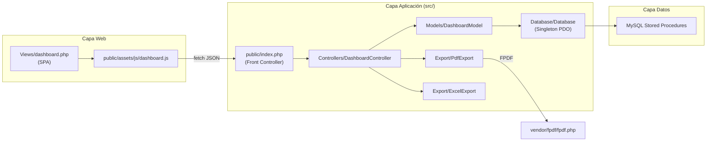

# C3 — Diagrama de componentes

Componentes internos del contenedor PHP.

## Componentes
- **Front Controller** (`public/index.php`): router por `?accion=`.
- **DashboardController**: coordina vista, API JSON y exports.
- **DashboardModel**: envuelve los SPs y normaliza datos.
- **Database**: Singleton PDO.
- **PdfExport / ExcelExport**: generación de reportes.
- **Views/dashboard.php + dashboard.js**: SPA del navegador.
- **Stored Procedures**: lógica de consulta y seguridad por rol.
