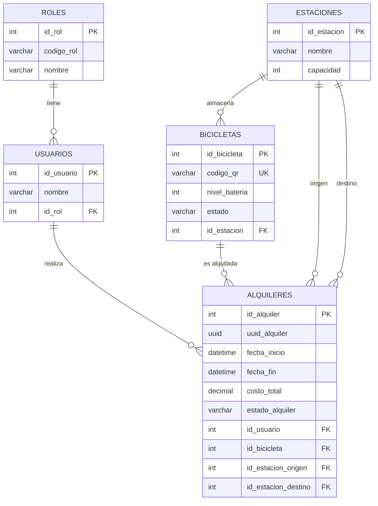

# Modelo relacional — Base de datos `ebike_management`

## Diagrama Entidad-Relación (Mermaid)

## Descripción de tablas

| Tabla | Descripción | Clave primaria |
|---|---|---|
| `roles` | Perfiles de usuario (ADMIN, SUPERVISOR, …) | `id_rol` |
| `usuarios` | Clientes del sistema | `id_usuario` |
| `bicicletas` | Flota de bicicletas eléctricas | `id_bicicleta` |
| `estaciones` | Puntos de alquiler/devolución | `id_estacion` |
| `alquileres` | Cada uso de una bicicleta | `id_alquiler` |

## Relaciones principales
- Un **rol** puede tener muchos **usuarios** (1:N).
- Una **estación** almacena muchas **bicicletas** (1:N).
- Un **usuario** realiza muchos **alquileres** (1:N).
- Una **bicicleta** participa en muchos **alquileres** (1:N).
- Un **alquiler** tiene estación de origen y de destino (N:1 hacia `estaciones`).

## Procedimientos almacenados relevantes
- `sp_reporte_estadisticas_admin`, `sp_alquiler_buscar_paginado`,
  `sp_histograma_duraciones`, `sp_indicadores_sistema`, `sp_validar_rol`.
