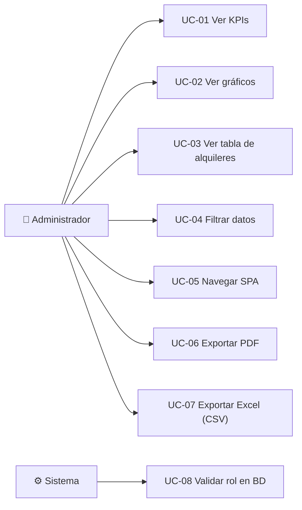

# Casos de uso — Ebike Manager

## Actor principal
- **Administrador / Supervisor** (rol ejecutor tomado de sesión).

## Diagrama de casos de uso (Mermaid)

## Descripción de casos de uso

### UC-01 Ver KPIs
- **Actor:** Administrador
- **Precondición:** Sesión con rol válido.
- **Flujo principal:** El sistema llama a `sp_reporte_estadisticas_admin` y
  muestra 6 tarjetas KPI.
- **Postcondición:** KPIs visibles y actualizados.

### UC-02 Ver gráficos
- **Actor:** Administrador
- **Flujo principal:** Se renderizan 5 gráficos (barras, histograma, línea,
  dona, radar) con etiquetas numéricas.

### UC-03 Ver tabla de alquileres
- **Actor:** Administrador
- **Flujo principal:** Se listan los alquileres con badges de color por estado
  y paginación de 12 filas.

### UC-04 Filtrar datos
- **Actor:** Administrador
- **Flujo principal:** El usuario selecciona filtros (estado, cliente, QR,
  periodo); el sistema aplica debounce y recarga datos sin recargar la página.

### UC-05 Navegar SPA
- **Actor:** Administrador
- **Flujo principal:** El usuario cambia de sección (Resumen / Gráficas /
  Alquileres) mediante el menú; la sección activa se muestra sin recarga.

### UC-06 Exportar PDF
- **Actor:** Administrador
- **Flujo principal:** Se capturan los 5 canvas a Base64, se envían por POST y
  el servidor genera un PDF APA con las imágenes aplanadas sobre blanco.

### UC-07 Exportar Excel (CSV)
- **Actor:** Administrador
- **Flujo principal:** Se generan los alquileres filtrados en CSV con BOM UTF-8
  y separador `;`.

### UC-08 Validar rol en BD
- **Actor:** Sistema
- **Flujo principal:** Cada SP invoca `sp_validar_rol`; si el rol no está
  autorizado, se lanza `SQLSTATE 45000`.
