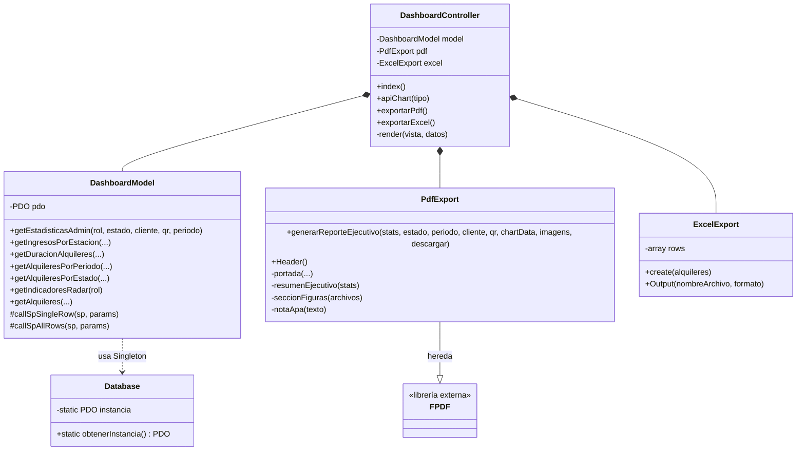

# Diagramas POO — Ebike Manager

## Diagrama de clases (POO) — Mermaid

## Principios POO aplicados
- **Encapsulación:** propiedades privadas (`$model`, `$rows`, `$instancia`).
- **Herencia:** `PdfExport extends \FPDF`.
- **Singleton:** `Database::obtenerInstancia()` garantiza una única conexión.
- **Composición:** `DashboardController` compone Modelo + Exportadores.
- **Abstracción:** el modelo oculta los SPs detrás de métodos con nombres de
  negocio (`getEstadisticasAdmin`, etc.).
- **Polimorfismo:** `Output()` de ExcelExport soporta distintos formatos (CSV).
